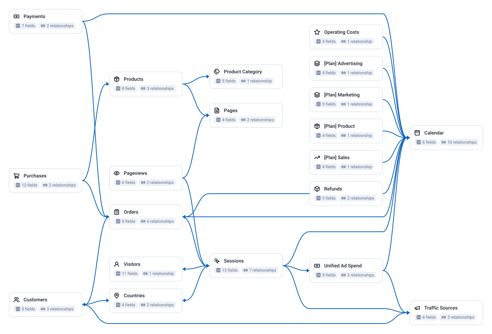

<!-- OWOX:GENERATED:START — regenerated on export, do not edit inside this block -->

**Authors:** [Vlad Flaks](https://github.com/vladflaks), [Rus Obolonsky](https://github.com/Obolrus)

| Data Mart | Fields |
|-----------|--------|
| [Calendar](./calendar.md) | 6 |
| [Countries](./countries.md) | 4 |
| [Customers](./customers.md) | 5 |
| [Operating Costs](./operating-costs.md) | 3 |
| [Orders](./orders.md) | 5 |
| [Pages](./pages.md) | 4 |
| [Pageviews](./pageviews.md) | 6 |
| [Payments](./payments.md) | 7 |
| [[Plan] Advertising](./plan-advertising.md) | 4 |
| [[Plan] Marketing](./plan-marketing.md) | 5 |
| [[Plan] Product](./plan-product.md) | 4 |
| [[Plan] Sales](./plan-sales.md) | 4 |
| [Product Category](./product-category.md) | 5 |
| [Products](./products.md) | 8 |
| [Purchases](./purchases.md) | 12 |
| [Refunds](./refunds.md) | 5 |
| [Sessions](./sessions.md) | 12 |
| [Traffic Sources](./traffic-sources.md) | 6 |
| [Unified Ad Spend](./unified-ad-spend.md) | 9 |
| [Visitors](./visitors.md) | 11 |

# Example Questions

- Which `traffic sources` and paid channels bring in the shoppers who actually convert, and what does each acquired `customer` cost versus the revenue they generate?
- How does the storefront funnel — `sessions` to `product views` to `orders` — convert, and where are the biggest drop-offs by `country`, `category` or landing `page`?
- Which `products` and `categories` drive the most revenue and repeat purchasing, and how does that shift across `countries` and over time?

# Explore this model

**[▶ Explore on canvas](https://model.owox.com/?okf=https://raw.githubusercontent.com/ikrasovytskyi/owox-model-canvas/main/bundles/e-commerce-extended/index.md)**

One click opens this model in a free OWOX canvas you can poke around in — no account needed.

<!-- OWOX:GENERATED:END -->

## Contexts

The business runs on four contexts. Each one answers to its own leader, and they share one model: a Data Mart listed under more than one context is shared — Calendar under all four — so Marketing's customers, Sales' orders and Finance's refunds are the same rows.

| Context | What it answers | Data Marts |
|---------|-----------------|------------|
| Marketing | Which channels bring shoppers who buy, at a return on ad spend the store can carry? | [Sessions](./sessions.md), [Visitors](./visitors.md), [Traffic Sources](./traffic-sources.md), [Unified Ad Spend](./unified-ad-spend.md), [Customers](./customers.md), [Countries](./countries.md), [Pages](./pages.md), [Pageviews](./pageviews.md), [[Plan] Marketing](./plan-marketing.md), [[Plan] Advertising](./plan-advertising.md), [Calendar](./calendar.md) |
| Sales | Is settled revenue growing year on year, across categories and markets? | [Orders](./orders.md), [Purchases](./purchases.md), [Customers](./customers.md), [Products](./products.md), [Product Category](./product-category.md), [Countries](./countries.md), [[Plan] Sales](./plan-sales.md), [Calendar](./calendar.md) |
| Product | Do storefront visits turn into orders, and which products carry them? | [Products](./products.md), [Product Category](./product-category.md), [Pages](./pages.md), [Pageviews](./pageviews.md), [Sessions](./sessions.md), [Orders](./orders.md), [[Plan] Product](./plan-product.md), [Calendar](./calendar.md) |
| Finance | How much of booked revenue does the store keep after refunds, fees and every cost? | [Payments](./payments.md), [Refunds](./refunds.md), [Operating Costs](./operating-costs.md), [Orders](./orders.md), [Purchases](./purchases.md), [Unified Ad Spend](./unified-ad-spend.md), [Customers](./customers.md), [Calendar](./calendar.md) |

## Model preview

