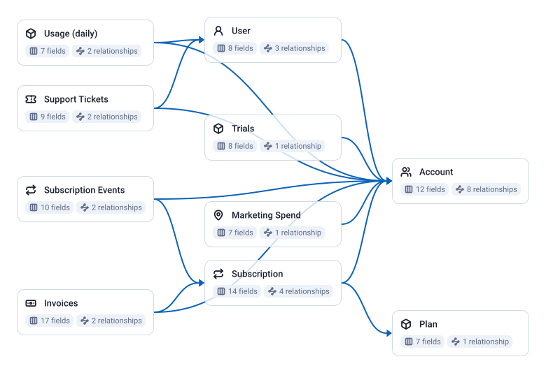

<!-- OWOX:GENERATED:START — regenerated on export, do not edit inside this block -->

**Authors:** [Vlad Flaks](https://github.com/vladflaks), [Rus Obolonsky](https://github.com/Obolrus)

| Data Mart | Fields |
|-----------|--------|
| [Account](./account.md) | 12 |
| [Invoices](./invoices.md) | 17 |
| [Marketing Spend](./marketing-spend.md) | 7 |
| [Plan](./plan.md) | 7 |
| [Subscription](./subscription.md) | 14 |
| [Subscription Events](./subscription-events.md) | 10 |
| [Support Tickets](./support-tickets.md) | 9 |
| [Trials](./trials.md) | 8 |
| [Usage (daily)](./usage-daily.md) | 7 |
| [User](./user.md) | 8 |

# Example Questions

- What is net revenue retention, and how much of it is expansion versus what contraction and churn take back?
- Which acquisition channels pay back their cost fastest once you account for the revenue those `accounts` actually retain?
- Do `accounts` with deeper `product usage` and better `support experiences` expand more and churn less?

# Explore this model

**[▶ Explore on canvas](https://model.owox.com/?okf=https://github.com/OWOX/models/tree/main/bundles/saas)**

One click opens this model in a free OWOX canvas you can poke around in — no account needed.

<!-- OWOX:GENERATED:END -->

## Contexts

The solution pages read three contexts that share one model: a Data Mart listed under more than one context is shared, so Growth's accounts, Revenue's subscriptions and Product's trials are the same rows.

| Context | What it answers | Data Marts |
|---------|-----------------|------------|
| Growth | Which channels bring in accounts at a cost per signup the business can sustain, and on which plans? | [Marketing Spend](./marketing-spend.md), [Account](./account.md) |
| Revenue | Is recurring revenue growing faster than churn and downgrades take it back, and is the billed revenue collected? | [Subscription Events](./subscription-events.md), [Subscription](./subscription.md), [Invoices](./invoices.md), [Plan](./plan.md), [Account](./account.md) |
| Product | Do trials turn into paying accounts, and are the people on those accounts using the product? | [Usage (daily)](./usage-daily.md), [Trials](./trials.md), [User](./user.md), [Plan](./plan.md), [Account](./account.md) |

## Model preview

