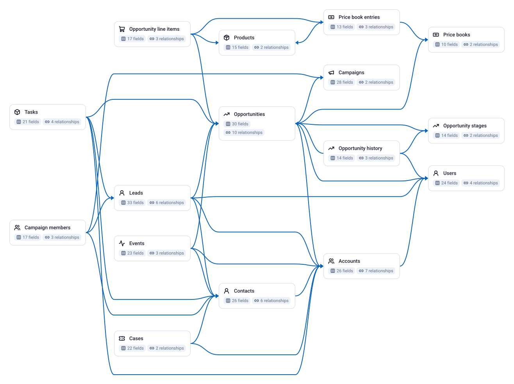

<!-- OWOX:GENERATED:START — regenerated on export, do not edit inside this block -->

| Data Mart | Fields | Description |
|-----------|--------|-------------|
| [Accounts](./accounts.md) | 26 | Companies and organisations in the CRM: customers, prospects, partners, with industry, size, owner and the parent account for hierarchies. |
| [Contacts](./contacts.md) | 26 | People at accounts: name, title, e-mail, phone, lead source and the account they belong to. |
| [Leads](./leads.md) | 33 | Prospects before they become contacts and accounts: status, source, company, owner and what they converted into. |
| [Opportunities](./opportunities.md) | 30 | Deals in the pipeline and closed: amount, stage, probability, forecast category, close date, owner, account and primary campaign. |
| [Opportunity line items](./opportunity-line-items.md) | 17 | Products on deals: product, quantity, unit and total price, and the price-book entry they were priced from. |
| [Opportunity history](./opportunity-history.md) | 14 | One row per change of a deal's stage, amount, probability, forecast category or close date. |
| [Opportunity stages](./opportunity-stages.md) | 14 | The sales process: every stage with its order, default probability, forecast category and closed / won flags. |
| [Campaigns](./campaigns.md) | 28 | Marketing campaigns as sales sees them: type, status, dates, cost and Salesforce's roll-ups of leads, responses, deals and won amount. |
| [Campaign members](./campaign-members.md) | 17 | Which leads and contacts touched which campaign, with status and first response date. |
| [Cases](./cases.md) | 22 | Support cases with status, priority, origin, reason, the contact and account, and when they closed. |
| [Users](./users.md) | 24 | Reps, managers and integration users: name, role, profile, manager, active flag. |
| [Tasks](./tasks.md) | 21 | Logged calls, e-mails and to-dos against leads, contacts, accounts and deals. |
| [Events](./events.md) | 23 | Calendar events (meetings, demos) against leads, contacts, accounts and deals. |
| [Products](./products.md) | 15 | The product catalogue as sales sells it: name, code, family, SKU, active flag. |
| [Price books](./price-books.md) | 10 | Price books: the standard one and any regional or partner books. |
| [Price book entries](./price-book-entries.md) | 13 | A product's list price in a given price book. |

# Example Questions

- What is the open pipeline by stage and by `owner`, how much of it closes this quarter, and what is the win rate and cycle length of the deals that closed?
- How many deals passed each stage, what share moved on, and how many days did they spend there (`opportunity history`)?
- Which `campaigns` touched the contacts of won deals before the close date, and what did those campaigns cost in the ad platforms?

# Explore this model

**[▶ Explore on canvas](https://model.owox.com/?okf=https://raw.githubusercontent.com/ikrasovytskyi/owox-model-canvas/main/bundles/salesforce/index.md)**

One click opens this model in a free OWOX canvas you can poke around in — no account needed.

<!-- OWOX:GENERATED:END -->

## Model preview

